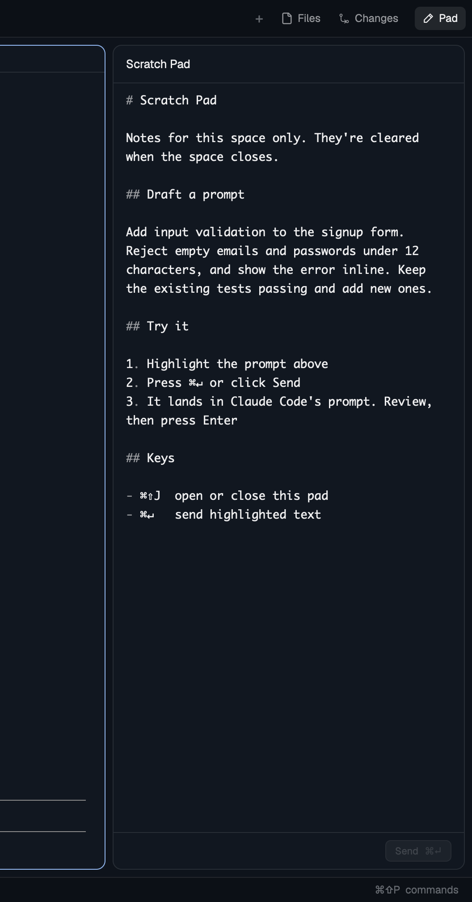

# herdr-mods

Mods for [Herdr](https://herdr.dev).

## Scratch Pad

A markdown notepad for each Herdr space, in a panel beside your terminals. Jot notes or draft a prompt, highlight part of it, and press ⌘↵ to paste it into the last terminal you used. It pastes without pressing Enter, so you can review before sending.



### Install

```sh
git clone https://github.com/jveldboom/herdr-mods.git ~/herdr-mods && ~/herdr-mods/install.sh scratchpad
```

This copies the mod into `~/.config/herdr-app/mods/scratchpad`, adds the Pad button and panel to the layout you're using, and merges its keys into your `keys.json`. Herdr's shipped layouts (like `main`) can't be edited in place, so for those the installer makes a copy named `<layout>-scratchpad`. Switch to it with ⌘⇧L. Your layout and keys files are backed up once as `*.bak`.

Options:

```sh
./install.sh scratchpad --layout NAME   # add it to a specific layout
./install.sh scratchpad --clone         # leave your layout alone; make "<layout>-scratchpad"
./install.sh scratchpad --remove        # take it out again (layout, keys and mod)
```

To update, run `git pull` in the clone and then run the install command again.

### Use

| Key | Does |
| --- | --- |
| ⌘⇧J (or the **Pad** button) | Open the pad, focus it, or close it and return to your terminal |
| ⌘↵ (or **Send**) | Paste the highlighted text into the last terminal you focused in this tab |

- **One pad per space.** Switching spaces switches pads, and each space remembers whether its pad was open.
- **Saved as you type.** Pads survive restarts and are deleted when their space closes.
- **Shared across machines.** A pad is saved on the machine its space runs on, in that machine's `~/.config/herdr-app/data/scratchpad/`. If two computers connect to the same machine, both see the same pad, and edits from one show up on the other within a few seconds. If both edit at the same moment, the last save wins.
- **Clipboard:** sending goes through the clipboard and puts your previous clipboard text back afterwards. Images and files on the clipboard aren't restored.

### Requirements

- macOS: sending uses `pbcopy` and `pbpaste`, and the keys are ⌘-based.
- `herdr-app` on your `PATH`, plus `python3` and `rsync` for the installer.
- A layout with Herdr's `tabs` mod and a block that shows the active tab, as `main` has.
- For remote spaces, a POSIX `sh` on the remote machine.

### What it accesses

The mod runs `sh`, `pbcopy` and `pbpaste` on this computer. For remote spaces it runs `sh` on that machine to read and write pad files. It only reads and writes files in Herdr's `data/scratchpad/` folder, and it makes no network requests of its own.

## Building your own

`scratchpad/RECIPE.md` is the build brief that herdr.dev uses: another agent could rebuild the mod from it starting with an empty folder. Read it for the internals and the pitfalls.

## License

[MIT](LICENSE)
