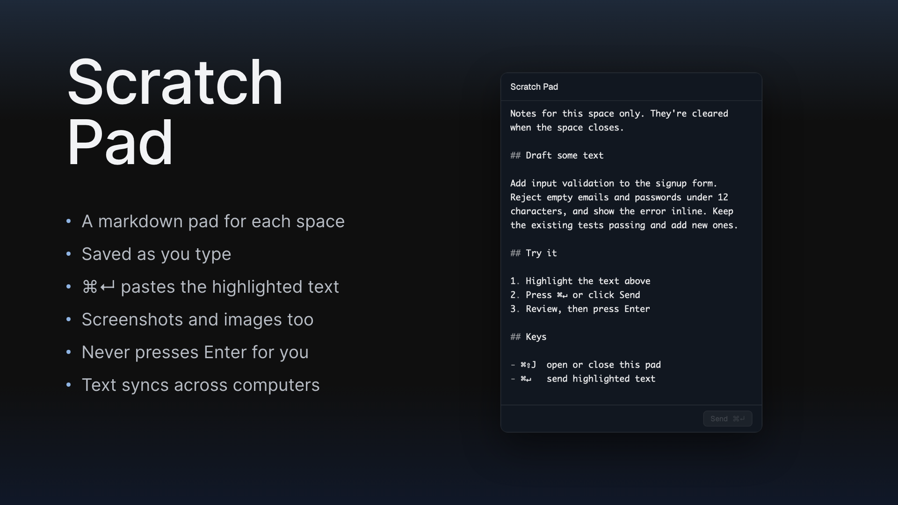

# Scratch Pad

A markdown notepad for each [Herdr](https://herdr.dev) space, in a panel beside your terminals. Jot notes, add screenshots or draft a prompt, highlight part of it, and press ⌘↵ to paste it into the last terminal you used. It pastes without pressing Enter, so you can review before sending.



## Install

```sh
git clone https://github.com/jveldboom/herdr-mods.git ~/herdr-mods && ~/herdr-mods/install.sh scratchpad
```

This copies the mod into `~/.config/herdr-app/mods/scratchpad`, adds the Pad button and panel to the layout you're using, and merges its keys into your `keys.json`. Herdr's shipped layouts (like `main`) can't be edited in place, so for those the installer makes a copy named `<layout>-scratchpad`. Switch to it with ⌘⇧L. Your layout and keys files are backed up once as `*.bak`.

Options:

```sh
./install.sh scratchpad --layout NAME   # add it to a specific layout
./install.sh scratchpad --clone         # leave your layout alone; make "<layout>-scratchpad"
./install.sh scratchpad --remove        # take it out again (layout, keys and mod)
```

To update, run `git pull` in the clone and then run the install command again.

## Use

| Key | Does |
| --- | --- |
| ⌘⇧J | Open the pad, focus it, or close it and return to your terminal |
| **Pad** button | Open or close the pad |
| ⌘↵ (or **Send**) | Paste the highlighted text and images into the last terminal you focused in this tab |
| ⌘V or image-file drop | Add an image at the pad's selection as a markdown image reference |

- **One pad per space.** Switching spaces switches pads, and each space remembers whether its pad was open.
- **Saved as you type.** Pads survive restarts and are deleted when their space closes.
- **Kept on this computer.** Every pad is saved in `~/.config/herdr-app/data/scratchpad/` here, including pads for spaces on other machines, so they work while those machines are offline. Sending to a remote terminal works the same way: Herdr copies images over and pastes their path.
- **Text syncs through the space's machine.** A remote space's text is also kept on that machine, so every computer connected to it sees the same pad. Edits go over as you save. The pad checks for other computers' edits only while it's open on a remote space and the window is visible (every few seconds while focused, less often when not), so a closed pad costs nothing. If both sides changed while one was offline, the pad keeps both versions, one after the other, and says so in its header. Images stay on the computer that added them: on other computers they show as "On another computer" and can't be sent from there.
- **Images:** pasted screenshots and dropped image files are converted to PNG (up to 10 MiB) and saved in `<space>.images/` next to the pad. They show as thumbnails under the text: click one to select it and see it larger, or hover and click × to remove it. Highlight the entire `` reference to send the image; select surrounding text too to paste both in order. Deleting a reference deletes its image after the pad saves (unless another reference still uses it). Closing the space deletes its images too.
- **Clipboard:** sending restores the previous clipboard, including images and file references. If you copy something during a send, it stops rather than overwriting your new clipboard.
- **Agent support:** images use the terminal's normal image-paste behavior, without pressing Enter. The target agent must accept image pastes; there is no automatic file-path fallback.

## Requirements

- macOS: image capture and sending use `osascript` with AppKit, and the keys are ⌘-based.
- `herdr-app` on your `PATH`, plus `python3` and `rsync` for the installer.
- For text sync, a remote machine needs only a POSIX `sh` and `stat` (macOS, Linux or BusyBox). The mod doesn't have to be installed there; if it is, that machine's own window shows the same pad.
- A layout with Herdr's `tabs` mod and a block that shows the active tab, as `main` has.

## What it accesses

The mod runs `sh` and `osascript` on this computer. On a remote space's machine it runs `sh` (through Herdr's own connection to that machine) to read and write that space's pad in its Herdr `data/scratchpad/` folder, and nothing else. It reads pasted image bytes or image files you drop into the pad. Stored files and private, temporary clipboard snapshots stay in Herdr's `data/scratchpad/` folder. It makes no network requests of its own.

## Building your own

[`RECIPE.md`](RECIPE.md) is the build brief that herdr.dev uses: another agent could rebuild the mod from it starting with an empty folder. Read it for the internals and the pitfalls.

## Files

- `src/`: the mod itself, copied into Herdr's `mods/scratchpad/`.
- `keys.json`: key bindings merged into your `keys.json`.
- `hooks/install.sh` and `hooks/layout.py`: add the Pad button and panel to a layout, and take them out again.
