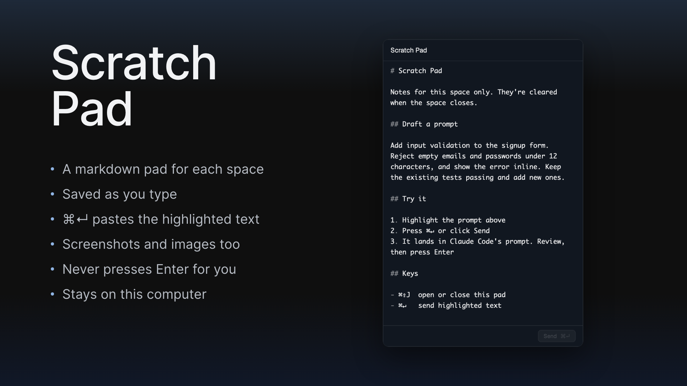

# Scratch Pad

A markdown scratch pad for each Herdr space, in a panel that slides in to the right of the terminals. Press Cmd+Shift+J (or the Pad button in the top bar) to open it, jot notes or draft a prompt, then highlight some text and press Cmd+Enter (or Send) to paste it into the last terminal you were in, without pressing Enter. Every space has its own pad, saved on this computer. A remote space's text is also kept in step with the copy on its machine, so every computer connected to that machine shares it. It survives restarts and is deleted when the space closes.

## What you see

- **Pad button**, in the top bar just right of Files and Changes: a 64px block beside the tab bar. A 26px-tall pill with 8px horizontal padding, 6px corners and 12px text, showing a 14px pencil icon (`pad.svg`, tinted) and the word "Pad". The block has a `chrome` background and a 1px `border` bottom line, so it reads as part of the tab bar. The pill is `selected` with `foreground` text while the panel is open, and `chrome` with `muted` text while it's closed. It turns `hover` under the pointer.
- **Scratch Pad panel**, a column between the terminals and the Files/Changes panel. It is 360px wide by default (min 240, max 900), hidden until opened, and drawn like the Files panel: `background` fill, 1px `border`, 10px corners, 13px text.
  - **Header:** 42px tall with 14px horizontal padding, 8px gap and a 1px bottom border. "Scratch Pad" in semibold. A failed save, read or sync adds an 11px `dim` note after it ("Not saved: …", "Not synced with vps: …", "Edited here and on vps at once: both versions are in the pad.").
  - **Editor:** fills the middle with 8px padding. Herdr's built-in `Editor` with markdown highlighting, the user's terminal font, soft wrap on, and no line numbers or folding. Syntax colors come from the theme: keyword `ansi5`, string `ansi2`, comment `dim`, function `ansi4`, type `ansi6`, number and constant `ansi3`, punctuation `muted`.
  - **Empty hint:** shown over an empty pad, centered horizontally and vertically, every line center-aligned, 12px text, 6px between lines, 24px side padding. The first line is in `muted`, the rest in `dim`:
    - Notes for this space
    - Highlight text, then ⌘↵ to send
    - Paste or drop images
    - ⌘⇧J to toggle
  - **Thumbnails:** when the pad references images, a row between the editor and the footer: 8px vertical and 14px horizontal padding, 6px gap, a 1px top border, wrapping onto more rows and scrolling past 150px. Each is a 64px square with 6px corners, a `raised` fill and a 1px `border` that turns `accent` under the pointer, showing the image in order of its reference. An image another computer added (synced text, see below) shows "On another computer" in 10px `dim` text instead; clicking it selects the reference but opens no preview. Clicking one selects its whole reference (ready for Send) and opens it in a dialog at 80% of the window, `openOverlay({mod: "scratchpad", kind: "dialog", props: {role: "preview", image}})`, centered at its own pixel size or shrunk to fit, never enlarged; a click or Esc closes it. Hovering shows an 18px round × in the top-right corner (`background` fill, 1px `border`, `hover` under the pointer). It removes the reference, and its line if that's all the line held, and stops the click from opening the preview; the next save deletes the file.
  - **Footer:** 8px vertical and 14px horizontal padding, 8px gap, a 1px top border. A status line on the left (empty unless a send was refused), the Send button on the right. The button is 24px tall with 10px horizontal padding, 6px corners, a `raised` fill and a 1px `border`, and reads "Send ⌘↵" with the shortcut at 70% opacity. With no text highlighted it is disabled: `dim` text at 50% opacity, with no pointer cursor and no hover. With text highlighted it has `foreground` text and turns `hover` under the pointer.

## How it behaves

- **Cmd+Shift+J:**
  - When the panel is closed, it opens and the cursor goes into the editor.
  - When the panel is open and you're typing in it, the panel closes and focus returns to the last terminal you used in that tab.
  - When the panel is open but you're elsewhere, the cursor moves into the pad.
- **Clicking Pad** opens the panel (cursor in the editor) or closes it and returns focus to the last terminal, wherever focus was.
- **One pad per space.** The panel always shows the focused space's pad and swaps text as you switch spaces. Text saves 400ms after you stop typing.
- **Open or closed per space**, like Files and Changes: each space remembers whether its pad was open, and switching spaces shows or hides the panel to match. New spaces start closed. This survives restarts.
- **Lifetime:** pads survive closing the panel, quitting Herdr and rebooting. A pad is deleted when its space closes, including spaces that are only in "recent". Pads for spaces on a machine that isn't connected, or that hasn't listed any spaces yet, are kept until that machine reports in.
- **Other machines:** pads for remote spaces are kept here too, so they open instantly and work offline. Sends to a remote terminal go through `terminal.paste`, which copies images to that machine and pastes their path. Another program changing a pad's file updates the open pad (the folder is watched). A failed save shows "Not saved: …" in the header until a save succeeds.
- **Text sync:** a remote space's text is also kept in that machine's `<Herdr home>/data/scratchpad/<space>.md`. That's the file the machine's own window uses for the space, so every computer connected to it shares one pad. Images aren't synced.
  - Each save here is copied there straight away. The copy there is checked only while the panel shows that space's pad, the window is visible and the machine is connected: every 3 seconds while the window is focused, every 15 seconds when it's only visible, backing off to a minute after failures. A closed panel, a hidden or minimized window, a local space and a disconnected machine cost nothing. Switching to a remote space checks it straight away.
  - Whichever copy changed since they last agreed wins. Unsaved edits are never replaced; their save syncs them. If both changed (say one computer edited offline), the pad keeps both: this computer's text, a `---` line, "Also edited on <machine>:", then the other text, on both sides. The header says so until the pad is edited.
  - A save that can't reach the machine says "Not synced: … isn't connected." in the header. It goes over when the machine is back, even with the panel closed.
  - The same applies to this computer's spaces: another computer writes their files here, and a save that finds its file changed since it was read keeps both versions the same way.
  - Images another computer added show as "On another computer" thumbnails. Sending one is refused ("That image was added on another computer, so it can't be sent from here.") rather than pasting part of the selection.
- **Sending** (Cmd+Enter or the Send button):
  - It sends only the highlighted text and complete image references; there is no "send everything".
  - The text goes to the last terminal focused in the current tab. It is pasted at the prompt without pressing Enter, and focus moves to that terminal.
  - The pad's text and selection are never changed by a send. If sending fails, the footer says why and the text is untouched.
  - With nothing highlighted, the footer says "Highlight the text you want to send." If no terminal has been focused in the tab yet, it says "No terminal to send to yet: click one first." A failed paste says "Send failed: …".
  - **No toasts or notifications, ever.** Every message is inline: the footer status, left of Send, in `dim` 11px text, truncated with an ellipsis. Typing or switching spaces clears it.
  - Text and images are pasted in selection order, waiting about half a second between parts. The full previous clipboard, including image and file types, is restored afterwards. If the user copies something during a send, the remaining pastes stop and the new clipboard is left alone. Sends cannot overlap.
- **Images:** paste a screenshot with Cmd+V or drop image files on the panel. Each is converted to PNG (at most 10 MiB) and inserted at the selection as ``. The cursor is left after the reference, with nothing selected, so typing doesn't replace it. Highlight the entire reference to send its image, optionally with surrounding text. Partial image-reference selections are refused. The target terminal/agent must support image pastes; there is no automatic file-path fallback or image editing.
- **Agent statuses** (working, blocked, done, idle) are not shown; the pad doesn't track agents.
- No animations.

## Built from

- **Mod** `mods/scratchpad/`: `main.js`, `mod.json` (`{"title": "Scratch pad", "place": "none", "focusable": true}`) and `pad.svg`, a 16×16 stroked pencil using `currentColor`. One module plays two roles, picked by `props().role`. Read `props()` rather than `init`'s first argument, which was empty in testing.
  - `"button"`, the Pad button. It is always on screen, so it receives `scratchpad.toggle` through `nextCommand()`. On every render it records `focused().terminal` per tab, which becomes the send target. It keeps a per-space open map in its `localStorage` (`"open"`). On a space switch it runs `layout.show` or `layout.hide` to match the map. Otherwise it records the panel's current state for the space, ignoring renders until a show or hide it issued has taken effect. When the set of spaces or ready machines changes, it deletes pad files and open-map entries whose space is gone, skipping spaces on machines that aren't `ready`.
  - `"pad"`, the panel. It follows `focused().space`, owns the `EditorState`, and handles sending.
  - Shared state lives at module scope, which is shared by both copies: pad text per space, the last terminal per tab, and whether the pad has focus.
- **Layout:** a clone of the shipped `main` layout (`layout.clone {name: "main", as: "main-scratchpad"}`) with two edits.
  - The `tabs` block (42px) becomes a row, `id: "tabs-row"`, 42px, `resizable: false`: the original `tabs` block at `weight: 1` (it keeps `window_drag`), then a block `scratchpad-button`, `px: 64`, `content: {mod: "scratchpad", props: {role: "button"}}`.
  - In `work-body`, right after `main`, a column `scratchpad-panel`, `px: 360`, `min: 240`, `max: 900`, `hidden: true`, holding one block `scratchpad-pad` with `{mod: "scratchpad", props: {role: "pad"}}`.
  - The toggle uses `layout.show` / `layout.hide {id: "scratchpad-panel"}`. Herdr saves the dragged width in `layouts/.state/`.
- **Keys** (`keys.json`, merged into the user's): `"layout:main-scratchpad": {"cmd-shift-j": "scratchpad.toggle"}` and `"mod:scratchpad": {"cmd-enter": "scratchpad.send"}`.
- **Storage:** `<Herdr home>/data/scratchpad/<encodeURIComponent(space id)>.md` on this computer, using `appHome()`, `fs/promises` and `watchFolder(dir)`. An empty pad has no file. The space id `vps/sp12` means space `sp12` on machine `vps`; a bare id is this computer.
  - Images are separate PNG files in `<encodeURIComponent(space id)>.images/` next to the markdown. Only references to that space's folder and generated 32-hex-digit PNG names are treated as attachments. A capture is written to a private `mktemp -d` folder, moved into place, then referenced, so its thumbnail finds the file on first load. After each save, files in the folder that the latest text doesn't reference are deleted. Cleanup failures say "Saved, but image cleanup failed: …".
  - Thumbnails use `image("data/scratchpad/<space>.images/<name>.png")`, which resolves against the Herdr home.
  - Cleanup deletes `.md` files, `.images` folders and `.base` files whose space isn't in `spaces()`, for machines that are ready and have listed spaces. For a synced pad it also deletes the copy on the space's machine; the `.base` stays until that works, so a later cleanup tries again.
  - Every write of a pad's own file is conditional: `writeTextFile(path, text, expected)` with the text last read or written, so a change from another computer is noticed instead of overwritten.
- **Sync** (`sync.js`): each call is one `exec(..., {on: machine})` running `sh` there. The other copy is at `${HERDR_APP_HOME:-$HOME/.config/herdr-app}/data/scratchpad/<encodeURIComponent(id on that machine)>.md`. A version is identified by a stamp (`stat` mtime, size and inode, or `none`): `stat -c` on GNU and BusyBox, `stat -f` on macOS and BSD. Every write replaces the file, so its inode changes even when the mtime is coarse.
  - Reading sends the stamp last seen: an unchanged copy costs one `stat`, and a changed one comes back in the same call. The reply ends with a marker, so output cut off by `exec`'s 8 MiB cap is an error, not a shorter pad.
  - Writing goes to a `mktemp` file next to the target, in 30,000-character pieces (Linux caps one argument at 128 KiB; surrogate pairs stay whole), then `mv` only if the target is still at the expected stamp. Exit code 3 means it changed. An empty pad deletes the file the same way.
  - `<space>.base` on this computer holds the text both copies last agreed on, so edits made while offline, or before a restart, are still told apart from the other side's. With no `.base` yet (first sync), an empty side takes the other's text and two different texts are both kept.
  - Saves and syncs of one pad run one at a time, in order.
- **Sending:** `clipboard.js` uses `osascript -l JavaScript` and AppKit to capture/convert images and save/restore all pasteboard items and their data types. Capture and snapshots write directly to private `mktemp -d` folders under `data/scratchpad/`, not stdout, avoiding exec/filesystem API size caps. Each part is copied as UTF-8 text or PNG/TIFF straight from the stored file, then `run("pane.focus", {terminal})`, a 60ms wait, `run("terminal.paste")`, and a 400ms wait. Restoration checks the pasteboard change count before replacing its contents, and the temporary directories are removed even on failure.
- **Herdr functions and commands:** `appHome`, `checking`, `exec`, `focused`, `layout`, `machines`, `nextCommand`, `props`, `run`, `settings`, `spaces`, `theme`, `watchFolder`, `window`, `writeTextFile`. Commands: `layout.show`, `layout.hide`, `pane.focus`, `terminal.paste`.
- **Programs:** `sh`, `mktemp`, `mv`, `rm` and `osascript` (macOS) on this computer. On a remote space's machine: `sh`, `stat`, `cat`, `printf`, `mkdir`, `mktemp`, `chmod`, `mv` and `rm`, inside its `data/scratchpad/` folder.

## Watch out

- **Cmd+Enter becomes a newline inside the editor.** The editor's own binding wins over `keys.json` and over `cx.bind_keys` (tried with contexts `ScratchPad`, `ScratchPad > Editor` and `ScratchPad > Input`). Without a guard, Cmd+Enter over a selection replaces the selected text with a newline. The working fix:
  - On `on_modifiers_changed`, when Cmd goes down, snapshot the value and selection.
  - On `change` while Cmd is held, if the new value is exactly the snapshot with its selected range replaced by `\n` plus optional spaces or tabs, call `set_value` and `set_selected_range` to restore the snapshot, then send from it.
  - Other Cmd edits (paste, cut, undo) don't match that pattern and pass through.
  - The send path only reads a snapshot and never writes to the editor.
- **The editor emits no selection events.** To enable Send only with a selection, re-check `selected_range()` on `on_mouse_up` and `on_key_up` of a wrapper div around the editor, and also on `on_key_down` (handling Cmd+A there by calling `set_selected_range` itself, so no timer is needed) and when Cmd is released: macOS sends no key-up while Cmd is held, so Cmd+A would otherwise never enable Send. Re-arm the Cmd+Enter snapshot at the same point. Take the snapshot in the Send button's `on_mouse_down`, before the editor loses focus. The button can briefly look enabled after a selection is cleared some other way; clicking it then only shows the "highlight" message in the footer.
- **The editor's `submit` event fires on plain Enter too.** Send from it only while Cmd is held (with the snapshot taken when Cmd went down). Otherwise every Enter in the pad counts as a send attempt.
- **`EditorState` has no placeholder option.** The empty hint is an `absolute().inset_0()` overlay with no mouse handlers, so clicks fall through to the editor. Re-render when the pad flips between empty and not.
- **There's no command to type text into a terminal without pressing Enter.** `hc send` always presses Enter, so the clipboard route is the only one.
- **A split pane can't be sized from code.** `pane.split` takes no size, and no command resizes a pane. That's why the pad is a layout panel and not a Cmd+D-style pane.
- **`<mod>.<command>` reaches only copies on screen.** A pad that is opened on demand can't receive its own toggle key, so the button role is always present.
- **The button block sits beside `tabs`, not inside it.** The shipped `tabs` mod is read-only, and the tab bar's 10px right padding sets the gap before Pad. Don't use a negative margin on the pill: it clips the rounded corner. A negative `gap` on the row is ignored.
- **Edit the mod under `~/.config/herdr-app/mods/`, not through a symlink.** Herdr doesn't notice saves made through a symlink and keeps running the old build. Copy the folder in instead (`install.sh` in this repo does that and runs `herdr-app check`).
- **A machine can report `ready` before its spaces are listed.** Cleanup skips a machine until it has listed spaces during the current ready connection. Afterwards an empty list means its last space closed, and cleanup still runs. This tracking resets when the machine is no longer ready.
- **There's no remote `writeFile` or `watchFolder`, and `exec` has no stdin.** `readTextFile` can read another machine's file, but writes have to travel as `exec` arguments, and changes there can only be noticed by asking. That's why images aren't synced (a 10 MiB image is hundreds of calls) and why the remote check is limited to a shown pad in a visible window.
- **`image()` fills its box and crops; there's no fit option.** The preview reads the PNG's width and height from its header (bytes 16 and 20) and sizes the box to match, using the dialog's size from `on_size_change`. Thumbnails are square crops on purpose.
- **Assumes macOS** (`pbcopy`, `pbpaste`, Cmd keys) and the `main` layout's node ids (`tabs`, `work-body`, `main`).

## Done when

- `herdr-app check ~/.config/herdr-app/mods/scratchpad` passes, and `herdr-app status` lists no errors from the mod or the layout.
- Pressing Cmd+Shift+J in `main-scratchpad` opens a 360px panel titled "Scratch Pad" with the cursor in the editor. Pressing it again while typing closes the panel and refocuses the last terminal.
- An empty pad shows the hint centered; typing hides it and deleting everything brings it back.
- The Send button is faded until text is highlighted, then lights up.
- Highlighting a few words and pressing Cmd+Enter pastes them at the last terminal's prompt without submitting. The pad still holds the same text with the same words highlighted.
- Switching spaces shows a different pad; switching back shows the first one's text.
- Opening the pad in one space and switching to a space where it was closed hides it; switching back shows it again.
- After quitting and reopening Herdr, the pad's text is still there.
- After the space closes, its file in `data/scratchpad/` is gone.
- Pasting a screenshot or dropping an image file inserts a markdown reference, stores a separate PNG and shows its thumbnail. Clicking the thumbnail selects the reference. Selecting the reference and sending invokes an image paste; a selection with text and multiple references pastes each in order.
- Deleting the last reference removes its PNG after saving. Closing the space removes its image folder.
- Sending restores a pre-existing image or file clipboard; copying something during a send leaves the new clipboard untouched.
- Writing a pad's `.md` file from outside Herdr updates the open pad within a moment; deleting it empties the pad.
- For a space on another machine, the pad's file is in this computer's `~/.config/herdr-app/data/scratchpad/`, and sending an image to a terminal there pastes a path to a copy on that machine.
- Typing in a remote space's pad updates `data/scratchpad/<space>.md` on that machine within a second. Editing that file there shows up here within 3 seconds while the window is focused. With the panel closed, or the window hidden, no `exec` reaches the machine.
- Editing on both sides while the machine is disconnected, then reconnecting, leaves both texts in the pad on both computers.
- Dragging the panel's edge to a new width, closing it and reopening it keeps that width.

