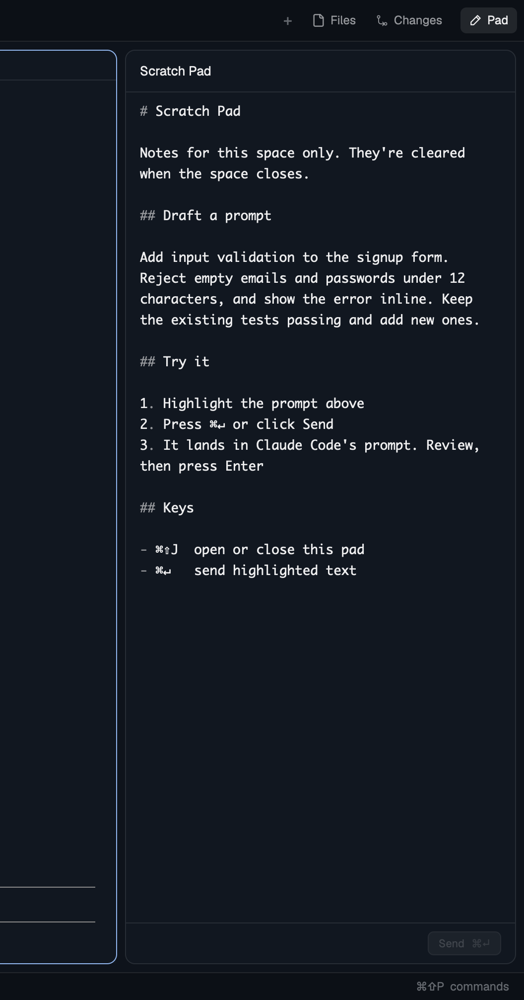

# Scratch Pad

A markdown scratch pad for each Herdr space, in a panel that slides in to the right of the terminals. Press Cmd+Shift+J (or the Pad button in the top bar) to open it, jot notes or draft a prompt, then highlight some text and press Cmd+Enter (or Send) to paste it into the last terminal you were in, without pressing Enter. Every space has its own pad, saved on the machine the space runs on, so every computer connected to that machine sees the same notes. It survives restarts and is deleted when the space closes.

## What you see

- **Pad button**, in the top bar just right of Files and Changes: a 64px block beside the tab bar. A 26px-tall pill with 8px horizontal padding, 6px corners and 12px text, showing a 14px pencil icon (`pad.svg`, tinted) and the word "Pad". The block has a `chrome` background and a 1px `border` bottom line, so it reads as part of the tab bar. The pill is `selected` with `foreground` text while the panel is open, and `chrome` with `muted` text while it's closed. It turns `hover` under the pointer.
- **Scratch Pad panel**, a column between the terminals and the Files/Changes panel. It is 360px wide by default (min 240, max 900), hidden until opened, and drawn like the Files panel: `background` fill, 1px `border`, 10px corners, 13px text.
  - **Header:** 42px tall with 14px horizontal padding, 8px gap and a 1px bottom border. "Scratch Pad" in semibold. While the space's machine can't be reached, an 11px `dim` note follows it: "Can't reach <machine>: edits won't be saved".
  - **Editor:** fills the middle with 8px padding. Herdr's built-in `Editor` with markdown highlighting, the user's terminal font, soft wrap on, and no line numbers or folding. Syntax colors come from the theme: keyword `ansi5`, string `ansi2`, comment `dim`, function `ansi4`, type `ansi6`, number and constant `ansi3`, punctuation `muted`.
  - **Empty hint:** shown over an empty pad, centered horizontally and vertically, every line center-aligned, 12px text, 6px between lines, 24px side padding. The first line is in `muted`, the rest in `dim`:
    - Scratch notes for this space.
    - Highlight text, then ⌘↵ or Send to paste it into your last terminal.
    - ⌘⇧J opens and closes this panel.
    - Saved on the space's machine; cleared when the space closes.
  - **Footer:** 8px vertical and 14px horizontal padding, a 1px top border, the Send button on the right. The button is 24px tall with 10px horizontal padding, 6px corners, a `raised` fill and a 1px `border`, and reads "Send ⌘↵" with the shortcut at 70% opacity. With no text highlighted it is disabled: `dim` text at 50% opacity, with no pointer cursor and no hover. With text highlighted it has `foreground` text and turns `hover` under the pointer.

## How it behaves

- **Cmd+Shift+J** (and clicking Pad):
  - When the panel is closed, it opens and the cursor goes into the editor.
  - When the panel is open and you're typing in it, the panel closes and focus returns to the last terminal you used in that tab.
  - When the panel is open but you're elsewhere, the cursor moves into the pad.
- **One pad per space.** The panel always shows the focused space's pad and swaps text as you switch spaces. Text saves 400ms after you stop typing.
- **Open or closed per space**, like Files and Changes: each space remembers whether its pad was open, and switching spaces shows or hides the panel to match. New spaces start closed. This survives restarts.
- **Lifetime:** pads survive closing the panel, quitting Herdr and rebooting. A pad is deleted when its space closes, including spaces that are only in "recent". Pads for spaces on a machine that isn't connected, or that hasn't listed any spaces yet, are kept until that machine reports in.
- **Across machines:** a pad is stored on its space's machine, in that machine's own Herdr home. Any screen showing the space (this computer, another computer connected to the same machine, or the machine's own Herdr window) reads and writes the same file.
  - Edits from another screen appear on their own: this computer's pad folder is watched, and a remote space's pad is re-read every 3 seconds while the panel shows it.
  - A pad with unsaved edits (typed in the last 400ms, or a failed save) isn't replaced by what's on disk. Two screens typing in the same pad at once: the last save wins.
  - A remote space opened before its machine answers shows an empty pad and the "Can't reach" note; the poll keeps retrying and loads the pad when the machine answers. Typing in the meantime isn't kept.
  - A failed save shows one toast ("Couldn't save the pad on <machine>: …") until a save succeeds again.
  - Pads that older versions kept on this computer for remote spaces are moved to the remote machine the first time they're opened.
- **Sending** (Cmd+Enter or the Send button):
  - It sends only the highlighted text; there is no "send everything".
  - The text goes to the last terminal focused in the current tab. It is pasted at the prompt without pressing Enter, and focus moves to that terminal.
  - The pad's text and selection are never changed by a send. If sending fails, a toast says why and the text is untouched.
  - With nothing highlighted, a toast says "Highlight the text you want to send." If no terminal has been focused in the tab yet, the toast says "No terminal to send to yet: click one first."
  - The clipboard is used for the paste and its previous text is put back about half a second later. Non-text clipboard contents (images, files) are not restored.
- **Agent statuses** (working, blocked, done, idle) are not shown; the pad doesn't track agents.
- No animations.

## Built from

- **Mod** `mods/scratchpad/`: `main.js`, `mod.json` (`{"title": "Scratch pad", "place": "none", "focusable": true}`) and `pad.svg`, a 16×16 stroked pencil using `currentColor`. One module plays two roles, picked by `props().role`. Read `props()` rather than `init`'s first argument, which was empty in testing.
  - `"button"`, the Pad button. It is always on screen, so it receives `scratchpad.toggle` through `nextCommand()`. On every render it records `focused().terminal` per tab, which becomes the send target. It keeps a per-space open map in its `localStorage` (`"open"`). On a space switch it runs `layout.show` or `layout.hide` to match the map. Otherwise it records the panel's current state for the space, ignoring renders until a show or hide it issued has taken effect. When the set of spaces or ready machines changes, it deletes pad files and open-map entries whose space is gone, skipping spaces on machines that aren't `ready`.
  - `"pad"`, the panel. It follows `focused().space`, owns the `EditorState`, and handles sending.
  - Shared state lives at module scope, which is shared by both copies: pad text per space, the last terminal per tab, and whether the pad has focus.
- **Layout:** a clone of the shipped `main` layout (`layout.clone {name: "main", as: "main-scratchpad"}`) with two edits.
  - The `tabs` block (42px) becomes a row, `id: "tabs-row"`, 42px, `resizable: false`: the original `tabs` block at `weight: 1` (it keeps `window_drag`), then a block `scratchpad-button`, `px: 64`, `content: {mod: "scratchpad", props: {role: "button"}}`.
  - In `work-body`, right after `main`, a column `scratchpad-panel`, `px: 360`, `min: 240`, `max: 900`, `hidden: true`, holding one block `scratchpad-pad` with `{mod: "scratchpad", props: {role: "pad"}}`.
  - The toggle uses `layout.show` / `layout.hide {id: "scratchpad-panel"}`. Herdr saves the dragged width in `layouts/.state/`.
- **Keys** (`keys.json`, merged into the user's): `"layout:main-scratchpad": {"cmd-shift-j": "scratchpad.toggle"}` and `"mod:scratchpad": {"cmd-enter": "scratchpad.send"}`.
- **Storage:** `<Herdr home>/data/scratchpad/<encodeURIComponent(local space id)>.md` on the space's machine. An empty pad has no file.
  - The space id `vps/sp12` means space `sp12` on machine `vps`; a bare id is this computer.
  - This computer: `appHome()` and `fs/promises`, and `watchFolder(dir)` for changes.
  - Another machine: the folder is `${HERDR_APP_HOME:-$HOME/.config/herdr-app}/data/scratchpad`, resolved once per machine with `exec("sh", ["-c", …], {on: machine})`. Reads use `readTextFile(path, {on})`. Writes go through `sh -c` with `on`: `printf %s "$2" >> file.tmp` in 30,000-character pieces (never splitting a surrogate pair), then `mv -f` over the pad. Deletes use `rm -f`.
  - Cleanup lists each ready remote machine's folder with `ls -1` and deletes pads whose `machine/id` isn't in `spaces()`, skipping names that decode to an id with a `/`.
- **Sending:** `exec("pbpaste")` saves the clipboard text to `data/scratchpad/.clipboard`. The selection is written to `.send` and copied with `sh -c 'pbcopy < "$1"'`. Then `run("pane.focus", {terminal})`, a 60ms wait, `run("terminal.paste")`, and about 400ms later the saved clipboard is restored and both temp files deleted.
- **Herdr functions and commands:** `appHome`, `checking`, `exec`, `focused`, `layout`, `machines`, `nextCommand`, `notify`, `props`, `readTextFile`, `run`, `settings`, `spaces`, `theme`, `watchFolder`. Commands: `layout.show`, `layout.hide`, `pane.focus`, `terminal.paste`.
- **Programs:** `sh`, `pbcopy` and `pbpaste` (macOS) here; `sh`, `printf`, `mkdir`, `mv`, `rm` and `ls` on remote machines.

## Watch out

- **Cmd+Enter becomes a newline inside the editor.** The editor's own binding wins over `keys.json` and over `cx.bind_keys` (tried with contexts `ScratchPad`, `ScratchPad > Editor` and `ScratchPad > Input`). Without a guard, Cmd+Enter over a selection replaces the selected text with a newline. The working fix:
  - On `on_modifiers_changed`, when Cmd goes down, snapshot the value and selection.
  - On `change` while Cmd is held, if the new value is exactly the snapshot with its selected range replaced by `\n` plus optional spaces or tabs, call `set_value` and `set_selected_range` to restore the snapshot, then send from it.
  - Other Cmd edits (paste, cut, undo) don't match that pattern and pass through.
  - The send path only reads a snapshot and never writes to the editor.
- **The editor emits no selection events.** To enable Send only with a selection, re-check `selected_range()` on `on_mouse_up` and `on_key_up` of a wrapper div around the editor. Take the snapshot in the Send button's `on_mouse_down`, before the editor loses focus. The button can briefly look enabled after a selection is cleared some other way; clicking it then only shows the "highlight" toast.
- **`EditorState` has no placeholder option.** The empty hint is an `absolute().inset_0()` overlay with no mouse handlers, so clicks fall through to the editor. Re-render when the pad flips between empty and not.
- **There's no command to type text into a terminal without pressing Enter.** `hc send` always presses Enter, so the clipboard route is the only one.
- **A split pane can't be sized from code.** `pane.split` takes no size, and no command resizes a pane. That's why the pad is a layout panel and not a Cmd+D-style pane.
- **`<mod>.<command>` reaches only copies on screen.** A pad that is opened on demand can't receive its own toggle key, so the button role is always present.
- **The button block sits beside `tabs`, not inside it.** The shipped `tabs` mod is read-only, and the tab bar's 10px right padding sets the gap before Pad. Don't use a negative margin on the pill: it clips the rounded corner. A negative `gap` on the row is ignored.
- **Edit the mod under `~/.config/herdr-app/mods/`, not through a symlink.** Herdr doesn't notice saves made through a symlink and keeps running the old build. Copy the folder in instead (`install.sh` in this repo does that and runs `herdr-app check`).
- **`writeTextFile` and `watchFolder` only work on this computer.** Remote writes go through `exec` with the text as an argument. Linux caps one argument at 128 KiB, so write in pieces. Remote changes are polled, not watched.
- **A machine can report `ready` before its spaces are listed.** Cleanup skips any machine with no spaces in `spaces()`, or it could delete every pad on it.
- **Assumes macOS** (`pbcopy`, `pbpaste`, Cmd keys) and the `main` layout's node ids (`tabs`, `work-body`, `main`).

## Done when

- `herdr-app check ~/.config/herdr-app/mods/scratchpad` passes, and `herdr-app status` lists no errors from the mod or the layout.
- Pressing Cmd+Shift+J in `main-scratchpad` opens a 360px panel titled "Scratch Pad" with the cursor in the editor. Pressing it again while typing closes the panel and refocuses the last terminal.
- An empty pad shows the four-line hint centered; typing hides it and deleting everything brings it back.
- The Send button is faded until text is highlighted, then lights up.
- Highlighting a few words and pressing Cmd+Enter pastes them at the last terminal's prompt without submitting. The pad still holds the same text with the same words highlighted.
- Switching spaces shows a different pad; switching back shows the first one's text.
- Opening the pad in one space and switching to a space where it was closed hides it; switching back shows it again.
- After quitting and reopening Herdr, the pad's text is still there.
- After the space closes, its file in `data/scratchpad/` is gone.
- Writing a pad's `.md` file from outside Herdr updates the open pad within a moment; deleting it empties the pad.
- For a space on another machine, the pad's file is in that machine's `~/.config/herdr-app/data/scratchpad/`, and a second computer connected to the same machine shows the same text within about 3 seconds.
- Dragging the panel's edge to a new width, closing it and reopening it keeps that width.

---

Created using Anthropic Claude. Keep this to internal versions until a person has reviewed and verified it.
